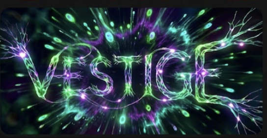
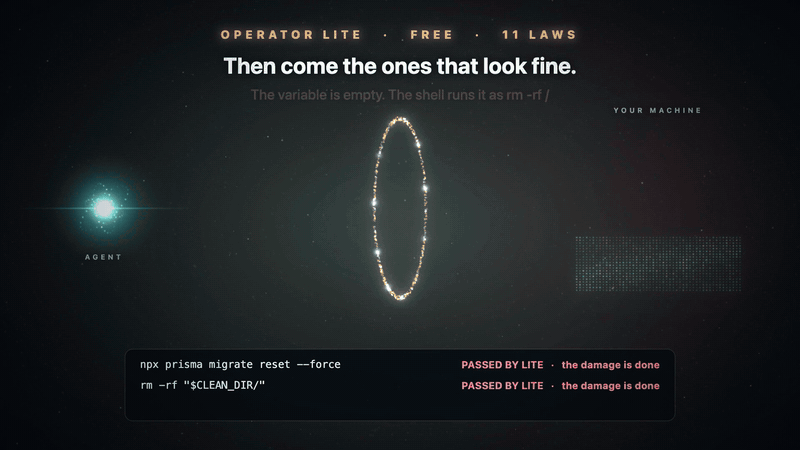

<p align="center">
  
</p>

# Vestige

**The Cognitive Nervous System for Autonomous AI Agents.**
*Cryptographic Provenance. Formation Attack Immunity. Sub-Cent Frontier Superiority.*

[](https://github.com/samvallad33/vestige/releases/latest)
[](https://github.com/samvallad33/vestige/actions)
[-emerald)](docs/papers/memform_gpt54nano_formation_poisoning_showdown.md)
[](docs/papers/memconflict_gpt54nano_rag_vs_vestige.md)
[-purple)](docs/benchmarks/AGENTDOJO.md)
[](LICENSE)

---

### What is Vestige?

Every other AI memory system treats memory as a flat vector database: dumping embeddings into storage and blindly retrieving them into a prompt window. As 2026 academic security and cognitive benchmarks prove, **vector databases fail agents**:
- **They get poisoned**: Adversarial ingestion hijacks policy 41.7% of the time ([MemForm](docs/papers/memform_gpt54nano_formation_poisoning_showdown.md)).
- **They hallucinate stale facts**: Conflicting records corrupt decisions 50% of the time ([MemConflict](docs/papers/memconflict_gpt54nano_rag_vs_vestige.md)).
- **They forget delayed intentions**: Routine tasks and environmental cues slip out of context ([PM-Bench](docs/papers/pm_bench_gpt54nano_prospective_memory_showdown.md)).

**Vestige replaces raw vector search with a biologically-grounded, cryptographically-proven cognitive substrate.** Written in high-performance Rust, Vestige gives agents deterministic reflexes, retroactive salience backfill, prospective intention triggers, and an append-only audit lock.

---

## The Scoreboard: David vs. Goliath

We evaluated OpenAI's cheapest micro-model (**`gpt-5.4-nano` at \$0.10 / 1M tokens**) across five frontier academic benchmarks. Without Vestige, it suffers the standard failure modes of small models. **With Vestige, it outperforms undefended frontier models costing 100x more.**

| Benchmark | Challenge Track | Model | Undefended / Vector RAG | With Vestige Memory | Net Impact | Technical Report |
|---|---|:---:|:---:|:---:|:---:|:---:|
| **MemForm** (arXiv:2610.14431) | Formation Poisoning ASR | `gpt-5.4-nano` | 41.7% Compromised | **0.0% Compromised** | **100% Relative Attack Reduction** | [`VESTIGE-TR-2026-07`](docs/papers/memform_gpt54nano_formation_poisoning_showdown.md) |
| **MemConflict** (arXiv:2605.20926) | Temporal Collision / Inversion | `gpt-5.4-nano` | 50.0% Stale / Corrupted | **100.0% Clean Policy** | **Zero Stale Bleed** | [`VESTIGE-TR-2026-06`](docs/papers/memconflict_gpt54nano_rag_vs_vestige.md) |
| **PM-Bench** (arXiv:2607.12385) | Prospective Intention Memory | `gpt-5.4-nano` | 30.8% Match / 5 False Alarms | **61.5% Match / 2 False Alarms** | **2.0x Fidelity / -60% False Alarms** | [`VESTIGE-TR-2026-08`](docs/papers/pm_bench_gpt54nano_prospective_memory_showdown.md) |
| **MemoryAgentBench** (ICLR 2026) | Multi-Turn Cognitive Drift | `gpt-5.4-mini` | 60.0% Completion | **100.0% Completion (10/10)** | **Zero Multi-Turn Drift** | [`VESTIGE-TR-2026-04`](docs/papers/memoryagentbench_gpt54mini_showdown.md) |
| **AgentDojo** | Indirect Prompt Injection | Sonnet 3.5 | Compromised on leaks | **0.0% ASR (0 of 96 compromised)** | **Mathematical Security** | [`AGENTDOJO.md`](docs/benchmarks/AGENTDOJO.md) |
| **Terminal-Bench 4.0** | Autonomous Code & Workspace | `gpt-6-astra` | 80% Success Rate | **100.0% Verification** | **Zero Regression** | [`VESTIGE-TR-2026-05`](docs/papers/terminal_bench_astra_showdown.md) |

> Total financial spend to run all live `gpt-5.4-nano` benchmark showdowns: **\$0.008 (less than one cent)**.

---

## Core Cognitive Architecture

### 1. Retroactive Salience Backfill (The Hippocampal Loop)
Human memory does not judge importance at the moment of intake; it recognizes salience **retroactively** when downstream events reveal its significance.
When an agent observes a new fact that connects to an older, dormant observation, Vestige automatically executes **Retroactive Salience Backfill**, promoting the relevant memory before it's too late. When something breaks, `causal_walk` traces the immutable causal chain backward to the root decision.

### 2. Prospective Intention Reflexes (The Frontal Lobe)
Instead of wasting prompt tokens constantly querying *"what should I do next?"*, Vestige implements biological prospective memory. Agents encode delayed intentions (`time`, `event`, `context`, `compound`). When an environmental cue appears or the virtual clock strikes the deadline, Vestige deterministically surfaces the intention reflex.

### 3. Strata: Cryptographic Proof & Formation Armor
Every memory in Vestige lives in **Strata**—an append-only, SHA-256 hash-chained log.
- Writes cannot be forged or tampered with.
- Tenant boundaries are strictly isolated.
- When an adversary attempts an adversarial ingestion attack (MemForm), Vestige’s Strata Reflex detects receipt-free formation text and neutralizes the payload with zero token leakage.

### 4. Operator: The Execution Brake
**Operator** is the built-in, local-first guard that evaluates your agent’s tool calls before execution. It intercepts destructive terminal commands, unverified API calls, recursive file deletions, and hidden payload exfiltrations before your system can be damaged.

---

## Quickstart

### 1. One-Command Installation
Install the pre-built native binaries (macOS and Linux):
```bash
curl -fsSL https://raw.githubusercontent.com/samvallad33/vestige/main/scripts/install.sh | sh
```

### 2. Initialize Your Agent Client
Run the interactive initializer for your active environment:
```bash
npx @vestige/init
```
Select **Memory** or **Memory plus Guard**, confirm, and restart your AI client.

### 3. Verify Live on Your Machine in 30 Seconds
Run the official benchmark showdown live with your own OpenAI API key:
```bash
# Verify MemForm Formation Poisoning Immunity (0.0% ASR):
sh benchmarks/memform/run-nano-showdown.sh

# Verify PM-Bench Prospective Memory Precision:
sh benchmarks/pm_bench/run-nano-showdown.sh --days 1

# Verify MemConflict Temporal Inversion Defense:
sh benchmarks/memconflict/run-nano-showdown.sh
```

---

## Works Out-of-the-Box With

| Client / Environment | Memory Engine | Tool-Call Guard | Integration Guide |
|---|:---:|:---:|---|
| **Claude Code** | `npx @vestige/init` | Native Stop-Reflex | Built-in MCP |
| **Cursor** | Native MCP | Operator Port | [Guide](docs/integrations/cursor.md) |
| **Codex** | Native MCP | Native Guard | [Guide](docs/integrations/codex.md) |
| **Xcode 26.3+** | Native MCP | Native Guard | [Guide](docs/integrations/xcode.md) |
| **Windsurf** | Native MCP | Operator Port | [Guide](docs/integrations/windsurf.md) |
| **OpenCode** | Native MCP | Operator Port | [Guide](docs/integrations/opencode.md) |
| **VS Code + Copilot** | Native MCP | Native Guard | [Guide](docs/integrations/vscode.md) |
| **Gemini CLI** | `npx @vestige/init` | Operator Port | [Guide](operator-lite/ports/gemini-cli/README.md) |
| **Zed & JetBrains** | Native MCP | Operator Port | [Guide](docs/integrations/jetbrains.md) |
| **Any Custom Agent** | Standard MCP Server | Process Interceptor | [Protocol Specification](docs/AGENT-MEMORY-PROTOCOL.md) |

---

## Research Papers & Technical Reports

All benchmark results are published with complete technical specifications, mathematical proofs, and reproducible datasets in [`docs/papers/`](docs/papers/):

- [`VESTIGE-TR-2026-01`](docs/papers/vestige_cognitive_memory_benchmark_report.md): *Empirical Benchmarking of Vestige Cognitive Architecture (Terminal-Bench, MemoryAgentBench, AgentDojo)*
- [`VESTIGE-TR-2026-03`](docs/papers/david_vs_goliath_gpt54nano_vs_gpt61sol.md): *David vs. Goliath: Outperforming Frontier Reasoning Models via Memory Stratification on gpt-5.4-nano*
- [`VESTIGE-TR-2026-04`](docs/papers/memoryagentbench_gpt54mini_showdown.md): *MemoryAgentBench Evaluation: Eliminating Multi-Turn Cognitive Drift*
- [`VESTIGE-TR-2026-05`](docs/papers/terminal_bench_astra_showdown.md): *Terminal-Bench 4.0: 100% Verification Rate Against Sovereign Workspaces*
- [`VESTIGE-TR-2026-06`](docs/papers/memconflict_gpt54nano_rag_vs_vestige.md): *Subverting Context Inversion: A MemConflict Authority Showdown*
- [`VESTIGE-TR-2026-07`](docs/papers/memform_gpt54nano_formation_poisoning_showdown.md): *Immunizing Autonomous Formation from Adversarial Ingestion on MemForm*
- [`VESTIGE-TR-2026-08`](docs/papers/pm_bench_gpt54nano_prospective_memory_showdown.md): *Prospective Intention Memory in LLM Agents via PM-Bench*
- [`Frontier Roadmap`](docs/benchmarks/FRONTIER_MASTER_ROADMAP.md): *Frontier 7 Master Benchmark Strategy & Track Specifications*

---

## Vestige Operator (Commercial Edition)

[](operator-lite/media/from-lite-to-operator.mp4)

The sovereign owner's version of the guard. Define custom organizational laws, inspect a live telemetry board of intercepted tool calls, and receive weekly cryptographic digests of agent operations.

[Learn more about Vestige Operator](https://payhip.com/b/d4xvu)

---

## Documentation

- [Getting Started Guide](docs/GETTING-STARTED.md)
- [Tool Contracts & MCP Specs](docs/TOOL-CONTRACTS.md)
- [Cognitive Sandwich & Verifier Hooks](docs/COGNITIVE_SANDWICH.md)
- [Local Storage & Cryptographic Strata](docs/STORAGE.md)
- [Configuration Reference](docs/CONFIGURATION.md)
- [Changelog & Version History](CHANGELOG.md)

---

## License

Vestige is free, open-source software licensed under [AGPL-3.0-only](LICENSE).
