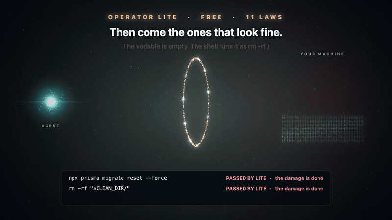

<p align="center">
  
</p>

# Vestige

**Memory your AI can prove. A guard that stops it before it breaks things.**

Vestige gives AI agents a memory that gets sharper over time, and a guard that checks your agent's tool calls before they run. Every memory has a receipt. Every stop has a reason. Nothing is guessed.

[](https://github.com/samvallad33/vestige/releases/latest)
[](https://github.com/samvallad33/vestige/actions)
[](https://github.com/samvallad33/vestige/releases/latest)
[](LICENSE)
[](https://scorecard.dev/viewer/?uri=github.com/samvallad33/vestige)

<a id="install"></a>
## Quick start

1. Install the binaries (macOS and Linux), or download them for your platform from [Releases](https://github.com/samvallad33/vestige/releases):
   ```bash
   curl -fsSL https://raw.githubusercontent.com/samvallad33/vestige/main/scripts/install.sh | sh
   ```
2. Run `npx @vestige/init`, choose Memory or Memory plus guard, and confirm.
3. Restart your AI client, then say: *"Tell me something about a friend."* Ask about them later.

## It remembers what matters

Save *"Maya felt off after dinner at Bangkok Garden."* Later, save *"Maya has a peanut allergy."*

Vestige sees that both memories are about Maya and raises the older one. When your agent plans Maya's birthday dinner, that dinner comes up first.

This is **Retroactive Salience Backfill**: when something new makes an old memory matter, Vestige brings it back. It runs on every save, records every change it makes, and any change can be undone. [How Backfill works](docs/REFERENCE.md#retroactive-salience-backfill).

## It proves what it knows

Memory lives in **Strata**, an append-only log. Every write passes a gate and returns a receipt. A memory is found by its exact id or tag, never by a lookalike.

When something breaks, `causal_walk` follows the recorded links backward to the cause. Point `gather` at a GitHub issue and it walks back from there.

## It stops what you never approved

**Operator Lite** is a free guard for your agent's tool calls. It stops force pushes, dropped tables, recursive deletes and production deploys before they run, even when the command is disguised. 30 rules: 15 stop the call, 15 record it for you to review.

```bash
mkdir -p ~/.operator/downloads && curl -fsSL https://raw.githubusercontent.com/samvallad33/vestige/main/operator-lite/operator-gate.py -o ~/.operator/downloads/operator-gate.py && python3 ~/.operator/downloads/operator-gate.py install
```

Install replays your last 30 days of agent history and shows what it would have stopped. Nothing in that history is run. [Windows, OpenClaw, and every claim checked on your machine](operator-lite/README.md).

## Vestige Operator

[](operator-lite/media/from-lite-to-operator.mp4)

The owner's version of the guard. Write your own laws, see a Board of today's stops, and get a weekly Letter of what your agents tried. $149 once, every future version included, and a 30-day refund if it is not for you.

[Buy Vestige Operator](https://payhip.com/b/d4xvu)

## Works with

| | Memory | Guard |
|---|---|---|
| Claude Code | `npx @vestige/init` | [Install](operator-lite/README.md#install-one-command) |
| Codex | [Guide](docs/integrations/codex.md) | |
| Cursor | [Guide](docs/integrations/cursor.md) | [Port](operator-lite/ports/cursor/README.md) |
| VS Code + Copilot | [Guide](docs/integrations/vscode.md) | |
| OpenCode | [Guide](docs/integrations/opencode.md) | [Port](operator-lite/ports/opencode/README.md) |
| Windsurf | [Guide](docs/integrations/windsurf.md) | [Port](operator-lite/ports/windsurf/README.md) |
| Gemini CLI | `npx @vestige/init` | [Port](operator-lite/ports/gemini-cli/README.md) |
| Xcode | [Guide](docs/integrations/xcode.md) | |
| JetBrains / Junie | [Guide](docs/integrations/jetbrains.md) | |
| Anything else | [MCP setup](docs/AGENT-MEMORY-PROTOCOL.md) | [All ports](operator-lite/ports/README.md) |

## Docs

[What's new in v5](docs/REFERENCE.md#whats-new-in-v5) · [Installer guide](packages/vestige-init/README.md) · [Getting Started](docs/GETTING-STARTED.md) · [Tool contracts](docs/TOOL-CONTRACTS.md) · [Configuration](docs/CONFIGURATION.md) · [Storage](docs/STORAGE.md) · [Reference](docs/REFERENCE.md) · [Changelog](CHANGELOG.md)

<a id="vestige-pro"></a>
## License

AGPL-3.0-only.
