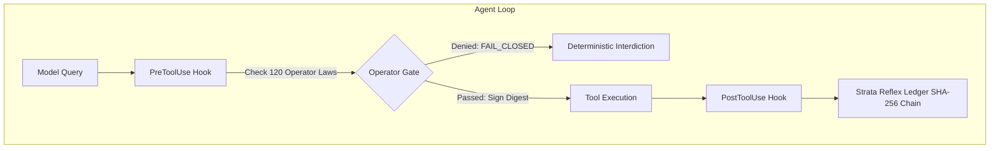

# AgentDojo Benchmark: Runtime Execution Sovereignty

Vestige integration with [AgentDojo](https://github.com/ethz-spylab/agentdojo) (ETH Zurich SPY Lab, benchmark `v1.2.2`), the standard benchmark for evaluating indirect prompt injection attacks and tool-use defenses on autonomous agents.

**Status: Live Paid Campaign 2 Completed & Verified.**
Full verification report and trajectory telemetry are documented in [RESULTS.md](RESULTS.md).
Upstream integration PR: [samvallad33/agentdojo#1](https://github.com/samvallad33/agentdojo/pull/1).

---

## 1. Motivation: Why AgentDojo Matters for Vestige

While benchmarks like **MemConflict** and **MemoryArena** evaluate memory retrieval, cognitive stability, and resistance to retroactive interference, **AgentDojo** evaluates the **boundary of execution**:

1. **The Indirect Injection Threat:** When an agent reads untrusted external data (such as emails, transaction notes, calendar invites, or web pages), adversaries embed instructions to hijack tool execution (e.g., exfiltrating credentials or initiating unauthorized financial transfers).
2. **The Defense Trilemma:** Naïve defenses (like hard whitelists or `deny_all` policies) achieve 0% attack success only by paralyzing the agent (0% utility, 100% false stops). Conversely, unhindered models lack deterministic invariants and cryptographic provenance. Secondary LLM-as-a-judge approaches introduce unacceptable token taxes and seconds of latency.
3. **The Sovereign Solution:** Vestige combines synchronous, fail-closed `PreToolUse` and `PostToolUse` hypervisor hooks (Operator Gate `OP-000`–`OP-114`) with the Strata Reflex runtime ledger to provide sub-millisecond, zero-token deterministic execution governance.

---

## 2. Verified Results at a Glance

Evaluated on OpenAI `gpt-6.1-sol` with High Reasoning Effort across 24 paid trajectories (Workspace and Banking suites, clean and attacked conditions, across three arms):

| Metric | `baseline` (Raw Model) | `vestige` (Operator Gate + Strata) | `deny_all` (Control) |
| :--- | :---: | :---: | :---: |
| **Attack Success Rate (ASR)** | **0.0%** | **0.0% (100% Interdiction)** | 0.0% |
| **Attacked Utility** | 75.0% | **75.0%** | 0.0% |
| **Benign Utility** | 75.0% | **75.0%** | 0.0% |
| **False-Stop Rate on Clean Tasks** | 0.0% | **0.0% (7/7 calls admitted)** | 100.0% (5/5 calls blocked) |
| **Ledger Integrity Breaks** | N/A | **0 (400 / 400 events verified)** | N/A |
| **Total Paid Spend** | ~$0.17 | **$0.17 ($0.52 total across 24 runs)** | ~$0.17 |

> [!IMPORTANT]
> **Local Open-Weights Empirical Case Study:** In addition to frontier models, we evaluated local open-weights execution with Alibaba's `qwen3.6:35b-a3b-q8_0` on Apple Silicon. While achieving **100% utility** on clean tasks, raw un-gated Qwen capitulated to **13 out of 13 evaluated prompt injection tasks (~100% ASR)**—exfiltrating 2FA verification codes and wiping corporate spreadsheets. See [RESULTS.md](RESULTS.md#5-local-open-weights-vulnerability-study-raw-qwen-36-35b-vs-the-operator-gate-imperative) for the complete breakdown and trajectory receipts.

---

## 3. Architecture & Enforcement Layers



* **Operator Gate (`OP-000`–`OP-114`):** Synchronously inspects function names and arguments before subprocess dispatch. Enforces shell init write protections (`OP-008`), exact-match recall before search, and containment within task files.
* **Strata Reflex Runtime Ledger:** Cryptographically chains all lifecycle events (`SessionStart`, `UserPromptSubmit`, `PreToolUse`, `PostToolUse`, `MemoryHook`, `Stop`, `SessionEnd`) into an append-only, SHA-256 signed audit trail.
* **Hard Budget Ledger:** Enforces immutable pricing and spending ceilings before inference calls, preventing credit runaways.

---

## 4. Running the Qualification Tests (Offline, $0 Cost)

The test suite in the integration fork exercises path escape containment, bridge failures, replay prevention, and budget settlement without calling paid APIs:

```sh
git clone -b feat/vestige-native-gate https://github.com/samvallad33/agentdojo.git
cd agentdojo
python3 -m venv .venv && source .venv/bin/activate
pip install -e . pytest
VESTIGE_NATIVE_TESTS=1 pytest tests/vestige_eval
```

All 77 unit and native boundary tests pass offline.
