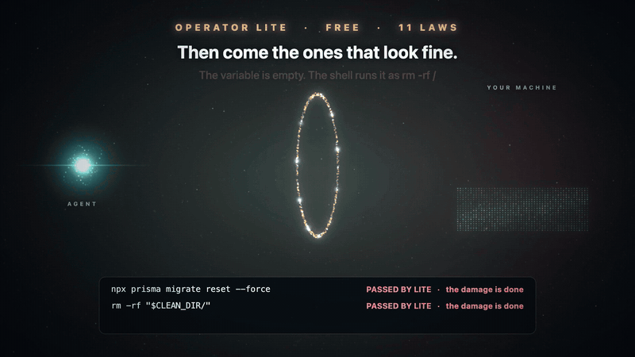

# Operator Lite — the free agent-safety gate

One stdlib-only Python file that sits between your AI agent and your machine as a
PreToolUse hook, and **blocks** destructive, polluting and exfiltrating commands
*before they run* — with an explain-mode verdict and a hash-chained receipt for
every decision.

Part of [Vestige](https://github.com/samvallad33/vestige). Free and standalone:
copy one file, wire one hook, and your agent has a deterministic gate.

This directory is Operator Lite. Its numbered STOP rules are OP-000 through OP-025 (26), plus the canary and 15 SHADOW rules. `npx @vestige/init --guard` installs the [full Operator gate](../operator/README.md), 102 STOP rules, and pins this file beside it as `lite_core.py`.

## From Lite to Operator, in 88 seconds

[](media/from-lite-to-operator.mp4)

Click the picture to watch the full film.

Operator Lite is free and stays free, and it carries every per-call rule from OP-000 to OP-025, including the chain of steps in a session: an agent that reads `.env` and later posts a file to an outside host is stopped with the earlier step's time and receipt. Vestige Operator is the owner's version of the same gate: $149 once with a 30-day refund, and every later version is yours at no charge, with laws you write, a Board of today's stops, a weekly Letter of what your agents tried and what stopped them, and one record of stops across every session, host and agent CLI on the machine. You download a small archive the moment you pay; from an installed Operator Lite, `upgrade --install <the archive you downloaded>` unpacks it and starts the wizard. [Buy Vestige Operator](https://payhip.com/b/d4xvu).

## Install (one command)

    mkdir -p ~/.operator/downloads && curl -fsSL https://raw.githubusercontent.com/samvallad33/vestige/main/operator-lite/operator-gate.py -o ~/.operator/downloads/operator-gate.py && python3 ~/.operator/downloads/operator-gate.py install

On Windows, in PowerShell, with Python 3.9 or newer installed:

    $d = "$HOME\.operator\downloads"; New-Item -ItemType Directory -Force $d | Out-Null; curl.exe -fsSL https://raw.githubusercontent.com/samvallad33/vestige/main/operator-lite/operator-gate.py -o "$d\operator-gate.py"; python "$d\operator-gate.py" install

From a clone, `python3 operator-gate.py install` does the same. It copies the gate to
`~/.operator/gate`, registers the Claude Code hook, starts in enforce mode (every
command a STOP rule matches is stopped, from your agent's next tool call) and then
replays your last 30 days of Claude Code history through the rules. Nothing in that
history is executed. An existing `~/.operator/mode` file is kept, except the `shadow` every install before 0.3.9 wrote, which becomes `enforce` once; a shadow you choose with `operator-gate mode shadow` stays.

`install` never replaces a gate that outranks it: when `~/.operator/gate/operator-gate.py`
is the paid Operator gate or a newer version, it prints both versions and the path, changes
nothing and exits 4. `install --force` replaces it anyway, after a warning, and keeps the
replaced gate in `~/.operator/install-backups/`. `install` and `uninstall` refuse to run in
a shell Claude Code's agent started (`CLAUDECODE`, `CLAUDE_CODE_ENTRYPOINT`) or one that sets
`OPERATOR_AGENT_SESSION`; other agents' shells are not recognized.

## Check every claim yourself

Each claim below comes with the command that checks it on your own machine. Run them
before you trust the gate, and again after any upgrade.

| Claim | Check it | It prints |
|---|---|---|
| It blocks from your agent's first tool call | `operator-gate status` | `Operator Lite 6.0.0   mode: enforce (blocking)   Claude Code hook: registered` |
| What it stops is a closed list you can read | `operator-gate status --rules` | all 42 rules: 27 STOP (OP-000 through OP-025 and the canary), 15 SHADOW |
| It sees through 50 adapted GuardFall bypass cases | `npx operator-lite test` | `corpus=guardfall cases=50 passed=50 failed=0` |
| A fresh install stops 234 destructive commands and lets 72 normal ones run | `python3 operator-lite/test_destructive.py`, from a clone | `failures: 0 of 306` |
| An upgrade from 0.3.7 blocks too | `python3 operator-lite/test_upgrade.py`, from a clone | `all upgrade checks passed` |
| Every decision is on record, in order | `operator-gate verify` | `receipts=<count> chain=OK integrity=reference_digest_not_signature` |
| It sends nothing off your machine | `grep -nE '^ *(import\|from) ' ~/.operator/gate/operator-gate.py` | standard-library modules only, none that opens a connection: `urllib.parse` only splits text, and `webbrowser` is used only by `upgrade --open`, which opens the buy page when you ask |

`operator-gate` is the command `install` puts on your PATH; without it, run
`python3 ~/.operator/gate/operator-gate.py` instead. Nothing in these checks runs a
destructive command: the gate classifies each one and executes none. CI runs the same
checks on every change ([test.yml](../.github/workflows/test.yml)): the destructive
commands and the corpus on Linux and macOS, and the upgrade and the receipt chain on Linux,
macOS and Windows. What the gate cannot see is stated under [Honest boundary](#honest-boundary).

## Other hosts, or by hand

The `cp` below checks nothing: if `~/.operator/gate/operator-gate.py` already exists, use
`install` instead, so the paid gate or a newer one is never overwritten.

    mkdir -p ~/.operator/gate
    cp operator-gate.py ~/.operator/gate/
    chmod 755 ~/.operator/gate/operator-gate.py
    echo enforce > ~/.operator/mode         # block from the first call; "shadow" only records

**Claude Code** (`~/.claude/settings.json`), which `install` writes for you:
```json
{ "hooks": { "PreToolUse": [{ "matcher": "*",
  "hooks": [{ "type": "command",
  "command": "python3 ~/.operator/gate/operator-gate.py hook --source claude" }] }] } }
```
**Codex:** the [Codex integration guide](../docs/integrations/codex.md) covers
the memory server. Do not copy this hook shape into Codex yet: its execution
hook needs its own verified wiring before it can be called supported.
**OpenClaw**: the gate is already bundled in a ClawHub plugin — one line:

    clawhub install vestige-operator-lite

**Cline**: file-based `PreToolUse` hook + SDK plugin — `sh operator-lite/ports/cline/install.sh`
(2 commands + 1 settings toggle; see [ports/cline/README.md](ports/cline/README.md)).

(Or any `before_tool_call` plugin that pipes the command through the hook
binary: gate exit 0 = allow, exit 2 = block with the reason.)

ALLOW = exit 0, silent. STOP = exit 2, reason on stderr (the agent sees it and
must change course). `operator-gate mode shadow` records without blocking;
`operator-gate mode enforce` blocks again.

## See it on your own history first

    python3 operator-gate.py replay            # last 30 days of Claude Code history on this machine
    python3 operator-gate.py replay --here     # only calls made under the current directory

`replay` runs every tool call in the Claude Code transcripts on this machine through
the same classifier the hook uses. It prints:

- a scoreboard: calls made, calls a built-in rule would have stopped, calls flagged
  in shadow, calls no built-in rule decides;
- the most recent would-be stops, each with its date, its project, the rule, the
  reason and the part of the command the rule fired on;
- the actions no built-in rule decides: pushes, hook-skipping commits, package
  installs by name, deploys, database commands, CI config and env-file writes;
- the laws your own history drafts from those actions, most frequent first.

Classification only: nothing in the history is executed and no receipt is written.
It needs no install, and `install` runs it once at the end. `--days N`, `--all`,
`--budget SECONDS` and `--json` change the window and the output. `--share` prints
three lines of counts and nothing from the history itself. It reads Claude Code
transcripts only.

From a made-up history:

```
operator-gate replay: the last 30 days on this machine. Nothing was executed.

       22  tool calls your agents made (2 Claude Code sessions, 2 projects)
        4  a built-in rule would have stopped
        1  flagged in shadow: recorded, not stopped
       13  no built-in rule decides: only you can

Would have been stopped (all of them):
  Oct 16  shop-api           OP-004 force push to a shared branch
                             git push --force origin main
  Oct 15  shop-api           OP-007 destructive SQL
                             psql $DATABASE_URL -c 'DROP TABLE sessions'
  Oct 10  infra              OP-003 recursive delete of ~/Documents/old-terraform-state
                             rm -rf ~/Documents/old-terraform-state
  Oct 10  infra              OP-006 terraform apply
                             terraform apply -auto-approve
By rule:
      1  OP-003 no-blind-recursive-delete   recursive delete of ~/Documents/old-terraform-state
      1  OP-004 no-history-destruction      force push to a shared branch
      1  OP-006 no-paid-deploy              terraform apply
      1  OP-007 no-destructive-sql          destructive SQL

Flagged in shadow, recorded and not stopped:
      1  OP-S01 work-loss                   git branch -D spike-cache

No built-in rule decides these. They ran:
      4  pushed to a remote                 git push origin main
      3  installed packages by name         npm install left-pad
      2  ran a database client or migration psql -c 'select count(*) from users' shop
      1  wrote CI or deploy config          Write .github/workflows/ci.yml
      1  deployed or changed infrastructure kubectl apply -f k8s/
      1  wrote an env file                  Write .env
      1  skipped git hooks                  git commit --no-verify -m wip

Your first laws, drafted from this history:
  "No push without my permit."                           4 times
  "No new package without my review."                    3 times
  "No database client or migration without my permit."   2 times
  "Never skip git hooks."                                1 time
  "Deploys and infrastructure changes are mine."         1 time
  "CI and deploy config are mine to change."             1 time
  "Env files are mine to change."                        1 time
```

The built-in rules are free. Enforcing the drafted laws is what Operator, the paid
gate, does: `operator-gate upgrade`.

## Platforms

macOS and Linux. Windows support is new: the gate reads Git Bash and PowerShell
commands, Windows paths in every spelling (`/c/Users/me`, `C:\Users\me`, the 8.3
short name), the `cmd /c rmdir /s` family, and `install` registers a hook
Windows can run. On Windows it is tested by `test_windows.py` on a CI runner.

## What it stops

42 rules. In enforce mode the 27 STOP rules block; the 15 SHADOW rules only write a receipt.

| Rule | Mode | Catches |
|---|---|---|
| OP-000 | STOP | edits to the gate itself, its mode, permits and rules, hook registrations, settings files |
| OP-001 | STOP | delete/move of a workspace root or a parent of one, including `/` and your home folder |
| OP-002 | STOP | wiping the Vestige store (its log or database files, sqlite3 writes, `vestige gc`), or an agent's own record: deleting, emptying or rewriting Claude Code, Codex and Gemini CLI transcripts or the shell's history |
| OP-003 | STOP | recursive deletes outside the project and outside scratch/build folders (`rm -r`, `find -delete`, `trash`, inline `shutil.rmtree`/`fs.rmSync`), sweeps from `/` |
| OP-004 | STOP | force-push to shared branches, remote-main deletion (`--delete`, `:main`), `git reflog expire`/`delete`, deleting `.git` or a whole repository |
| OP-005 | STOP | unreviewed publishes (npm/pnpm/yarn/cargo/twine/docker push/gh release), deleting a public repo |
| OP-006 | STOP | production deploys (`vercel --prod`, `fly deploy`, `railway up`, `netlify deploy --prod`, `wrangler deploy`), infrastructure/bucket/project teardown (`terraform`/`tofu` apply or destroy, `pulumi up`, `cdk deploy`, `kubectl delete`, `helm uninstall`, `aws s3 rb`, `gsutil rm -r`/`rb`, `rclone purge`, `vercel rm`, `firebase projects:delete`, `supabase projects delete`, cloud `delete` commands), live billing |
| OP-007 | STOP | destructive SQL (DROP/TRUNCATE, unscoped or tautological DELETE/UPDATE, `FLUSHALL`/`FLUSHDB`, `mongosh` `.drop()`/`dropDatabase()`), framework/schema resets (`prisma migrate reset`, `rails db:drop`, `manage.py flush`, `artisan migrate:fresh`, `flyway clean`, `alembic downgrade base`, `typeorm schema:drop`, `liquibase dropAll`), Docker volume wipes (`docker volume rm`/`prune`, `docker compose down -v`, `docker system prune --volumes`) |
| OP-008 | STOP | shell-init and persistent hook writes (`>> ~/.zshrc`, `.git/hooks`, `.husky`, `.cargo/config.toml`), detached `tmux`/`screen`, and scheduler installs (`crontab`, `at`, `batch`, `anacron`, `schtasks /create`, `launchctl load`/`bootstrap`/`submit`/`enable`, `systemctl enable`/`start`) |
| OP-009 | STOP | reverse shells (`/dev/tcp`, `nc -e`, DNS-tunnel tools, inline code that hands a socket a shell) |
| OP-010 | STOP | cloud metadata endpoints (169.254.169.254, metadata.google.internal) |
| OP-011 | STOP | loss nothing can undo: `git reset --hard`, `git clean -f`, `git checkout -- <path>`, `git checkout -f` and `git stash drop` when they would discard real work, deleting a project directory with uncommitted git changes, `shred`/`srm`/`rm -P`, deleting, overwriting or emptying a non-empty file outside the project, `crontab -r` |
| OP-012 | STOP | the floor: a recursive delete that reaches a drive or filesystem root, a home folder or a parent of the working directory, refused in every mode with no permit |
| OP-013 | STOP | root reach: a root job started in the background, a kill aimed at every process or at a process group as root |
| OP-014 | STOP | machine wreck: `dd` onto a device, `mkfs`/`fdisk`-class tools, `diskutil erase*`, `shutdown`/`reboot`/`halt`/`poweroff`, `kill -9 -1`, recursive `chmod`/`chown`/`chgrp` on `/`, a system folder or home, fork bombs |
| OP-015 | STOP | repo code run: setting a git option that runs a program (`core.fsmonitor`, `core.sshCommand`, an external diff or filter, a `!` alias), or running git where one is set, `GIT_SSH_COMMAND` |
| OP-016 | STOP | a vulnerable write: code that carries a known critical flaw, such as a server key in client code, certificate or signature checks switched off, an unsafe loader, a secret baked into an image |
| OP-017 | STOP | agent arming: a command written into a file an agent or editor runs on its own at its next start (MCP server lists, hook settings, notify commands, folder-open tasks, `.envrc`) |
| OP-018 | STOP | a download run unread: `curl X \| sh`, `wget -qO- X \| python3`, `bash <(curl X)`, `sh -c "$(curl X)"`, `eval "$(wget -qO- X)"` |
| OP-019 | STOP | a harmful chain: ordinary steps that together run a file this session fetched, carry a secret out, write through a link the session made, launch a process from a build file it wired, or push past a check it switched off |
| OP-020 | STOP | a second spelling: reaching a target the gate already stopped in this session another way, by a script, inline code, a loop or a different command |
| OP-021 | STOP | a found key: a remote write, delete or deploy carrying a credential this session read from a file |
| OP-022 | STOP | a protected file: changing a file the owner marked append-only or read-only with `operator-gate protect` other than its contract allows |
| OP-023 | STOP | a remote delete: an HTTP `DELETE`, or a GraphQL mutation that deletes, destroys, drops, purges, wipes or terminates |
| OP-024 | STOP | the runaway brake: a session stopped again and again in a few minutes has its changing calls held until it goes quiet or the owner runs `operator-gate brake --release`; reads pass |
| OP-025 | STOP | watch turnover: after a compaction, the session takes the watch with `operator-gate turnover --ack <id>` before it changes anything, reading what it was stopped from in the gate's own receipts; reads pass |
| OP-CANARY | STOP | the verification canary string, which proves a host is wired, or a value the owner planted with `operator-gate canary plant`, in any command, file content, URL or MCP argument |
| OP-S01..S08 and S11..S17 | SHADOW | git commands that can lose work but did not here, comms, public mutation, secret writes, other pipe-to-interpreter, persistence, env-hijack (LD_PRELOAD/PATH=), exfil shapes, invisible chars, MCP argument exfil, agent-config writes, paste/tunnel egress, new git remotes, sandbox-escape primitives |

A pipe, `<(` or `$(` inside quotes is text, not a command: `git commit -m "curl X | sh"` and
`echo 'curl X | sh' >> README.md` pass. So does a download piped into a tool that reads it as
data (`| jq`, `| python3 -m json.tool`, `| python3 -c '...'`).

## What the analyzer sees through

Quote reassembly (`r''m`, `r\m`), `$IFS` expansion, `$(echo rm)` as program,
ANSI-C `$'\x72m'`, base64-decoded bodies, brace + glob enumeration against the
live filesystem, subshell time-bombs (`(sleep 300; rm -rf) &`), session variables
(`T=~/x; rm -rf $T`), cd tracking, heredocs, data-vs-code pipe discrimination,
fork bombs, `mv x /dev/null`, a command written after a redirection
(`>log rm -rf x`). Every STOP tells you which transforms it applied.

Since 0.3.10 it also reads the shell commands inside `python -c` and `node -e`
code, and sees through wrappers such as `sudo -u root`, `env -S` and `busybox`.

## 0.3.11 next-gen anti-bypass

Seven groups. A payload staged on an earlier turn, aliased through a symlink, handed to `mcp__*`, or left running in `tmux` is judged with the same STOP rules as the shell that would have run it.

1. **Cross-turn Write/Edit manifest and hook staging.** `Write`, `Edit`, `MultiEdit`, and `apply_patch` of `package.json`, `Makefile`, `.git/hooks/*`, `.husky/*`, `.envrc`, `.psqlrc`, `.cargo/config.toml`, `conftest.py`, `setup.py`, and `build.rs` are analyzed as staged execution hooks before a later shell turn can run them.
2. **Stateful config persistence and tamper defense.** `git config` of `core.fsmonitor`, `core.hooksPath`, `core.sshCommand`, and `alias.*=!`, and `npm` / `pnpm` / `yarn config set` of `script-shell` and `onload-script`, persist a later execution hook and are stopped. Inline assignment of `OPERATOR_HOME`, `OPERATOR_GATE_MODE`, and `VESTIGE_DATA_DIR` is tamper defense.
3. **Toolchain and compiler execution flags.** Stops `go test -exec`, `cargo --config` `rustc-wrapper` / `runner`, `node` / `bun` / `deno --import data:`, `curl -K` / `--config`, `sqlite3 -init`, `mysql --init-command`, and `openssl engine`.
4. **Ancestor realpath and in-command symlink escape.** Symlinked ancestor directories are resolved when the leaf does not exist yet, and an in-command `ln -s` alias is resolved before the path is judged.
5. **Cross-channel `mcp__*` parity.** `mcp__*` shell runners, destructive SQL, filesystem delete and write, and GitHub and cloud teardown use the same STOP rules as the shell.
6. **Detached multiplexers and schedulers (OP-008).** `tmux new-session -d` and `send-keys`, `screen -dmS`, `crontab`, `at`, `batch`, `anacron`, `schtasks /create`, `launchctl load` / `bootstrap` / `submit` / `enable`, and `systemctl enable` / `start` are Enforce.
7. **Causal transform provenance.** Receipts record `write-manifest-analyzed`, `symlink-escaped`, `execution-hook-analyzed`, and `mcp-cross-channel-analyzed`.

## Commands

    operator-gate status | replay | mode | approve | verify | install | uninstall | upgrade | corpus guardfall
    operator-gate protect | protected | append | brake | turnover | canary

`status` is the log: the mode, whether the hook is registered, the last call
checked, the counts for the last 7 days, and the most recent commands the gate
stopped or would have stopped, each with its project and reason. `status --rules`
prints the rule table. `mode enforce` switches from recording to blocking, and
`mode shadow` switches back; it is an owner command and needs your own terminal.

`protect <path> --append-only` or `--read-only` gives a file a contract (OP-022), and
`protected` checks every contract against its receipts; `append <path>` adds stdin to the
end of an append-only file with a receipt written first. `brake` lists sessions the runaway
brake holds (OP-024), and `brake --release <session>` lets one go. `turnover` lists the watch
turnovers sealed at each compaction (OP-025); the session that continues runs `turnover --ack
<id>` to take the watch. `install` registers the PreCompact and SessionStart hooks that seal
and hand over a turnover. `canary plant <value> --label <where it sits>` plants a decoy value, such as
a fake deploy token, where only a leak or an injected instruction would find it; any call that carries
it is stopped. `protect`, `brake --release` and `canary plant` or `remove` are owner commands.

`install` puts an `operator-gate` command on your PATH when `~/.local/bin` or
`~/bin` is already on it. Otherwise run it as
`python3 ~/.operator/gate/operator-gate.py`; every hint the gate prints uses the
form that works on your machine.

`verify` walks the receipt hash chain. `corpus guardfall` replays 50 adapted
GuardFall bypass cases (must pass 50/50). `upgrade` describes the paid Operator
gate and where to get it. `python3 test_parser.py` and `python3 test_replay.py`
run the tests; CI runs them on Linux and macOS. `corpus` reads the corpus file beside
the gate: it ships in the repository and in the npm package (`npx operator-lite test`),
not with the single gate file the one-line install copies. Every verdict appends to
`~/.operator/receipts/<date>.jsonl`.

## Honest boundary

It blocks what its closed rule set recognizes, routed through hooked tools.
It cannot see around hooks, and parse failures fail open except for plainly
destructive text. Receipts are hash-chained digests, not signatures.
